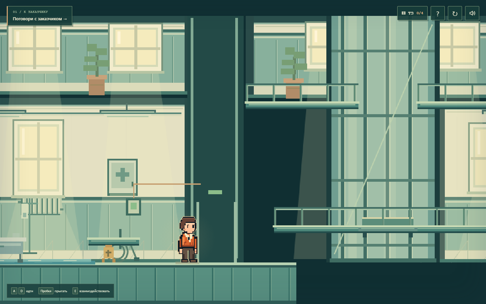

# Баг в больнице

Пиксельная браузерная игра о профессии системного аналитика. В больнице сломалась запись пациентов: поговорите с заказчиком, соберите требования, постройте алгоритм и передайте решение программисту.

**HTML · CSS · JavaScript · Canvas 2D** — без сборки и внешних зависимостей.



## Запуск

Скачайте или клонируйте репозиторий и откройте [index.html](index.html) в современном браузере. Установка зависимостей и подключение к интернету не нужны.

При желании можно запустить локальный сервер из папки проекта:

```powershell
python -m http.server 8080 --bind 127.0.0.1
```

Затем откройте [игру на локальном сервере](http://127.0.0.1:8080).

Все пути к ресурсам относительные. Для размещения на статическом хостинге нужны `index.html`, `src/` и `assets/`, сохраняя их расположение.

## Что реализовано

- Три разные карты: приёмное отделение, диагностический корпус и технический этаж. Платформы, лестницы, лифты, кнопки, двери и контрольные точки.
- Четыре задачи заказчика с тремя вариантами ответа. Правильные решения формируют техническое задание, ошибки сопровождаются объяснением.
- Интерактивная схема записи и отмены: перетаскивание карточек, установка кликом, обмен, удаление, отмена действия и проверка решения.
- Финальный разговор с программистом и пять сценариев: успешная запись, конфликт времени, нерабочие часы, отмена и повторная запись.
- Анимации персонажей и окружения, фоновая музыка и звук открытия интерфейсов.
- Сохранение этапа, сложности, ответов и схемы в `localStorage`. Положение героя и кнопки внутри маршрута пока сбрасываются после перезагрузки.

## Сложность

| Режим | Заказчик | Схема |
| --- | --- | --- |
| Легко | Короткие вопросы, заметно разные ответы | Подробные подписи и подсказки |
| Средне | Более похожие варианты ответов | Общие подсказки, перемешанные карточки |
| Сложно | Формальные условия и близкие варианты | Нейтральные цвета, минимум подсказок, две лишние карточки |

Настройка меняет мини-игры. Карты и физика одинаковые во всех режимах. «Продолжить» возобновляет сохранённую смену с её сложностью; выбор в меню применяется при начале новой смены.

## Управление

| Действие | Клавиши |
| --- | --- |
| Движение | A / D или ← / → |
| Прыжок | Пробел, W или ↑ |
| Лестница вверх / вниз | W / S или ↑ / ↓ |
| Взаимодействие | E |
| Следующая реплика | Enter |
| Закрыть ТЗ, справку или подтверждение перезапуска | Esc |

Используются физические коды клавиш, поэтому русская раскладка тоже работает. В HUD доступны ТЗ, справка, перезапуск и выключение звука. Музыка запускается после первого действия; настройка звука сохраняется.

На телефоне есть кнопки движения, прыжка и взаимодействия. Отдельной кнопки спуска по лестнице пока нет. Для схемы доступны мышь, касание или Tab и Enter.

В конструкторе перетащите блок слева в пунктирное место. Другой способ — выбрать блок и нажать на нужное место. Уже установленные блоки можно перетаскивать друг на друга для обмена. На ветке «Пациент отменяет запись?» разместите освобождение времени. Нажмите «Проверить решение», затем передайте схему программисту. Проверки на пяти пациентах доступны только на заключительном, четвёртом этапе миссии. На телефоне палитра и схема прокручиваются по горизонтали.

## Структура проекта

```text
.
├── index.html                  # Точка входа
├── src/
│   ├── app.js                  # Экраны, переходы и сохранение
│   ├── audio.js                # Музыка и звуковые эффекты
│   ├── data.js                 # Диалоги, сложности, требования и сценарии
│   ├── designer.js             # Интерактивный конструктор схемы
│   ├── game.js                 # Карты, управление, физика и Canvas-графика
│   └── logic.js                # Проверка алгоритма и модель записи
├── assets/
│   ├── audio/
│   │   ├── open-window.mp3     # Открытие интерфейса
│   │   └── soundtrack.mp3      # Фоновая музыка
│   └── css/
│       ├── base.css            # Базовые стили и общие элементы
│       ├── designer.css        # Конструктор схемы
│       ├── game-shell.css      # Полноэкранная игра и HUD
│       └── screens.css         # Меню, диалоги, ТЗ и финал
├── docs/
│   ├── images/gameplay.png     # Скриншот для README
│   ├── DEVELOPER_2_PLAN.md     # Сюжет и взаимодействия
│   └── PROJECT_REVIEW.md       # Анализ проекта и список доработок
├── .editorconfig               # Единое оформление текстовых файлов
├── .gitattributes              # Переносы строк и бинарные ресурсы
├── .gitignore                  # Исключения для локальных файлов
└── README.md
```

Код подключается обычными скриптами через пространство имён `Hospital`, поэтому игра работает и при прямом открытии HTML. Порядок подключения в `index.html` важен: данные и логика загружаются до приложения.

## Документация и ограничения MVP
- [Анализ проекта: найденные ошибки и порядок доработок](docs/PROJECT_REVIEW.md).

Модель записи использует одну дату, одного врача и часовые слоты с 09:00 до 18:00. Схема проверяется по заданному правильному решению; финальные сценарии запускают готовую модель записи. Свободное исполнение произвольной схемы пока не реализовано.

Для локальных экспериментов используются игнорируемые папки `.artifacts/` и `.local/`. Резервные копии, браузерные профили и временные файлы не входят в публикуемый проект.
